## Overview

Zino is a Linux lab box. The path, at a high level:

- Guest access to an SMB share exposes a log file with application credentials
- The Booked Scheduler web app accepts those credentials, and its admin panel allows a file upload that turns into code execution as `www-data`
- A root cron job runs a script that `www-data` can modify, which gives root

**Tools:** nmap · enum4linux · smbclient · a web browser

## Recon

```
nmap -p- -sCV -oN nmapscan 192.168.173.64
```

The scan shows a small set of services: FTP (21), SSH (22), SMB (139/445), a MariaDB port that refuses connections from my host (3306), and an Apache server on 8003 with a directory listing. The `smb-security-mode` output shows the `guest` account is used for the session, and that message signing is disabled.

## Enumeration: SMB

`enum4linux` lists two shares. Only `zino` is accessible, and it's read-only for our session:

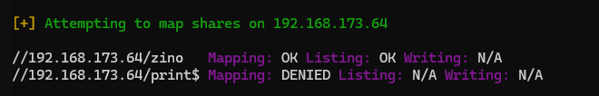

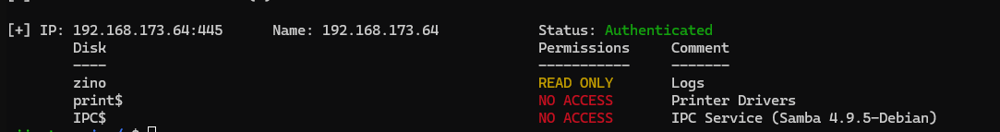

The share looks like a user's home directory, and it contains a `misc.log` file. Connecting as guest and listing the share shows it's read-only:

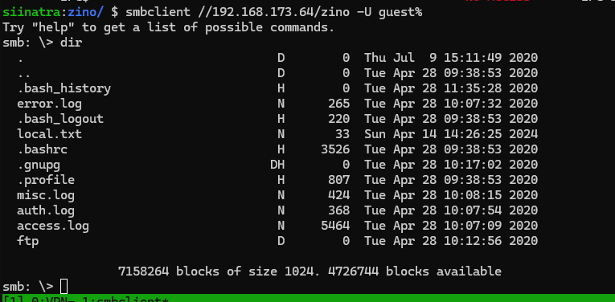

The log file records a session setup for the web application, and that line includes a username and password. Those credentials are the foothold into the web app.

## Enumeration: web app

Port 8003 hosts a login page for **Booked Scheduler**:

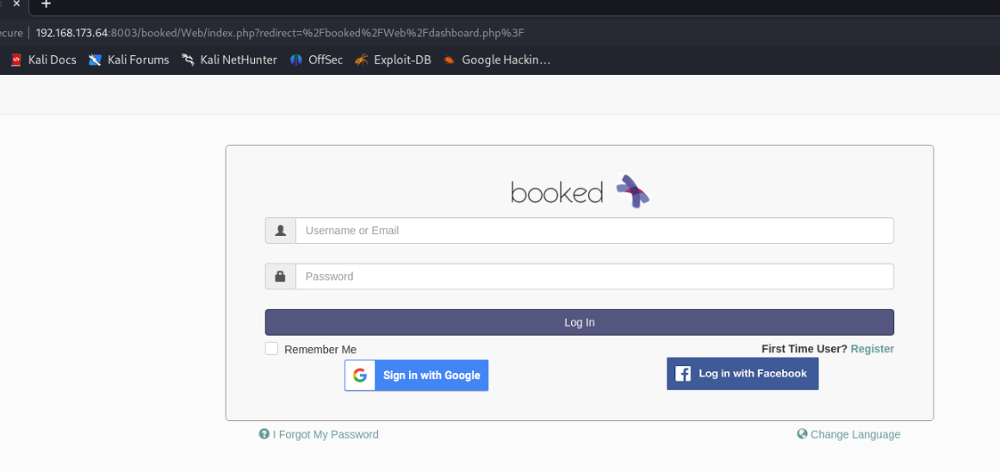

The credentials from the log file log in as the application admin:

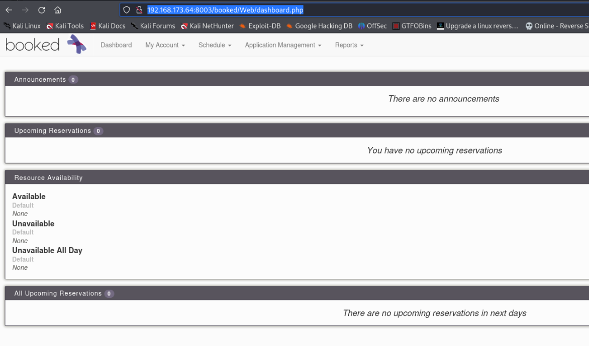

The footer shows the version:


## Foothold

Booked Scheduler 2.7.5 has a public write-up for an authenticated code-execution issue in the admin theme page, where the upload checks don't stop a PHP file from being saved in a web-reachable location. The public script for it was broken, so I used a manual version of the exploit instead. The admin theme page is where the file goes:

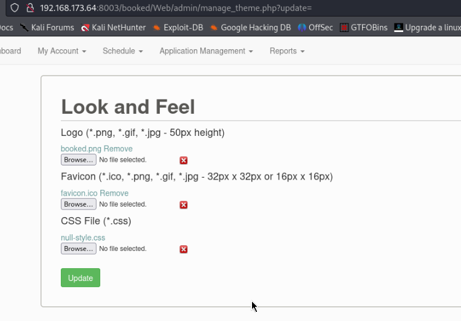

Once the file is in place, commands run as `www-data`:

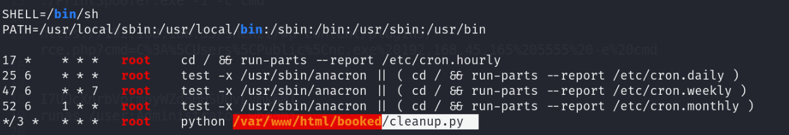

From that point, a reverse shell gives an interactive session on the listener:

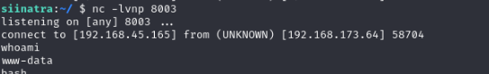

I'm leaving out the exact steps and payloads here.

## Privilege escalation

Once on the box as `www-data`, the local checks show a few things. The user list shows a home directory for `peter`:

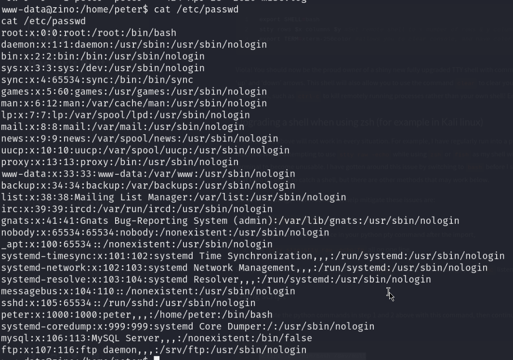

The root crontab runs a helper script every three minutes:

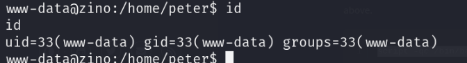

That script lives in the web application's directory, and it's writable by `www-data`:

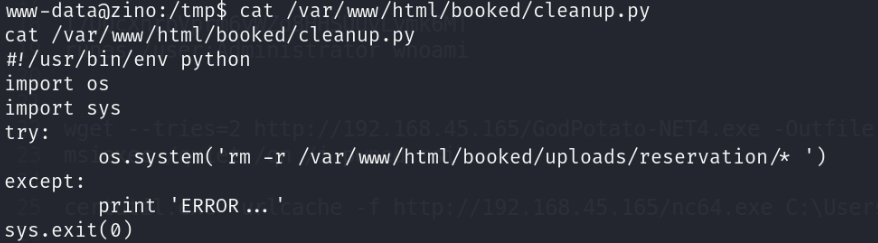

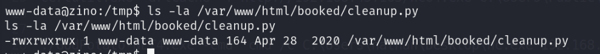

Replacing the contents of the script with a command to get a shell means the next cron run executes it as root. The root shell is the end of the chain:

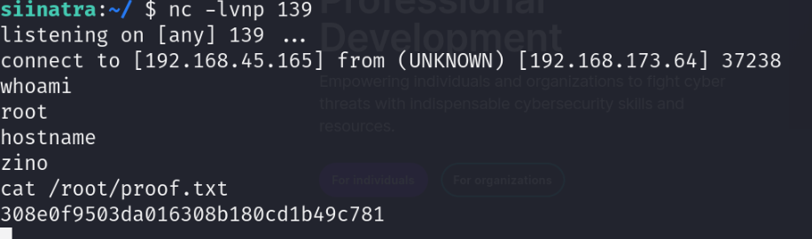

## Takeaways

- **Credentials in logs.** Application logs often capture setup commands. Guest-readable log shares leak them.
- **Upload filters.** Checking the extension name alone is not enough; PHP files can be disguised, and the web server still runs them.
- **Writable cron targets.** Any script a root job runs must be owned by root and not writable by others.

## References

- [Booked Scheduler — project page](https://www.bookedscheduler.com/)
- [Cron jobs and file permissions — HackTricks](https://book.hacktricks.xyz/linux-hardening/privilege-escalation#cron-jobs)
